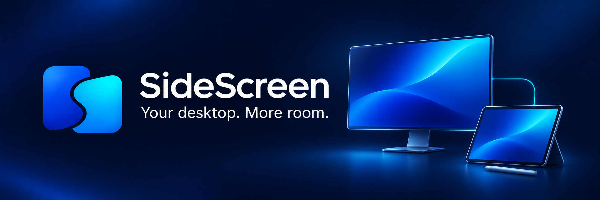

<div align="center">



***Turn another Windows PC into an interactive extension of your desktop.***

[](#requirements)
[](#current-status)
[](https://github.com/EEkebin/SideScreen/actions/workflows/prerelease.yml)

**[Downloads](https://github.com/EEkebin/SideScreen/releases)** · **[Quick start](#installation)** · **[Controls](#controls)** · **[Documentation](#development)**

</div>

---

More space for your work. A touchscreen for your desktop. A pen surface for the apps you already use.

SideScreen extends your Windows desktop onto a second PC over Wi-Fi or Ethernet, with encrypted video and native mouse, keyboard, touch and pen input. Use a normal LAN or a direct cable with static IPs. There is no cloud account, relay or internet service in the connection path.

## **Downloads**

**[Open the newest prerelease →](https://github.com/EEkebin/SideScreen/releases)**

One download works on either PC. Choose how you want to run it; every prerelease includes both formats and `SHA256SUMS.txt`.

| Platform | Portable | Installer |
|:---|:---|:---|
| **Windows 11 x64** ? Server + Client + About | `SideScreen-<version>-win-x64.zip` | `SideScreen-<version>-Setup-win-x64.exe` |

> **Server driver required.** The Server needs the separately installed SideScreen/DM virtual-display driver. The current driver is a development test-signed component. Neither the portable apps nor the installers install it or change Windows signing policy. The Client does not need a display driver. See [driver setup and status](docs/EXTENDED-DISPLAY.md).
>
> These are unsigned development prereleases, not a signed, turnkey driver installation for a new PC.

## **Requirements**

- **Windows 11 x64** on both PCs.
- A reachable IPv4 connection over Wi-Fi or Ethernet. Static addresses work; DHCP is optional.
- A compatible D3D11 GPU and H.264 encoding/decoding support.
- The virtual-display driver and administrator elevation on the Server.
- A touchscreen or compatible pen on the Client to use those input features.

The apps include their WinUI runtime. Running them does not require Python, SSH, Visual Studio or a separate WinUI installation.

## **Installation**

### Choose your format

**Installer:** run the SideScreen Setup executable. It installs for your Windows user, adds a Start menu shortcut, and offers a desktop shortcut. The same installation includes Server and Client pages. It appears in Windows **Settings > Apps > Installed apps**. During uninstall, check **Remove saved settings on this PC** for a fresh start, or leave it unchecked to keep your setup. The separately installed display driver stays installed.

**Portable:** extract the entire ZIP and run `SideScreen.exe`. Keep the DLLs, resources and icon beside the executable.

### Connect your screens

1. Open **SideScreen** on the desktop PC and select **Server** in the left sidebar.
2. Click **Start Driver** and approve the separate helper's administrator prompt. The Server waits for a connection; it does not create an empty extra screen yet.
3. Open the same **SideScreen** app on the second PC and select **Client**. Enter the Server's IPv4 address from its address list and click **Connect**.
4. Move an application onto the new display. Arrange it in **Windows Settings → System → Display**, just like a physical monitor.

The Client supplies its display resolution and refresh preference. SideScreen selects a supported mode, targeting up to 60 fps. Later Windows resolution, orientation and arrangement changes take precedence. Layout preferences are remembered by client IPv4 address and resolution profile.

No codes, pairing, accounts or per-connection approval are required. While **Start Driver** is active, reachable LAN clients can receive a display and, if enabled on the Server, control input. Connections are encrypted but do not verify peer identity; use this mode on a trusted LAN.

Both pages show addresses from connected physical adapters. The Server never needs the Client's address. No automatic discovery is required.

## **Features**

| | What you can do |
|:---|:---|
| **Multiple extended monitors** | Connect up to four clients at once, each with its own Windows monitor, resolution, orientation and position. |
| **Connection quality** | Choose Auto, Sharp or Smooth from the client toolbar Settings menu. Show statistics only when you want them; adaptation leaves the Windows display layout alone. |
| **GPU video** | D3D11 capture, H.264 encoding, GPU decoding and presentation. Native 3000×2000 with a 60 fps target is tested on a Surface Book 2; delivered frame rate depends on the hardware and network. |
| **Touch and pen** | Native multi-touch and exposed pen pressure, tilt, buttons, inversion and eraser semantics. Support depends on the device and receiving app. |
| **Mouse and keyboard** | Click, drag, scroll and type; pause remote input without closing the display. |
| **Windowed or fullscreen** | Resize freely, maximize, or use the small disappearing local toolbar. |
| **Direct LAN** | Wi-Fi, Ethernet and reachable static-IP connections, with TLS 1.3 encryption and automatic connections. |
| **Tray controls** | Close the window to hide the app. Reopen it from the tray; use tray **Exit** to quit. |
| **Persistent server** | Disconnect the Client and reconnect later. The Server keeps listening. Only the disconnected client?s monitor is removed; other clients keep working. |

The left sidebar keeps **Server** and **Client** separate, with **About** at the bottom. Switching pages does not disconnect either role. The main app and receiving client run without administrator rights; only the server helper is elevated.

## **Controls**

| Action | Control |
|:---|:---|
| Disconnect the Client | **Ctrl+Shift+Q** or **F9** |
| Toggle fullscreen | **F11** |
| Reveal the toolbar | **F10** |
| Pause/resume remote input | **F8** |
| Reveal with a mouse | Hover briefly at the **top center** |
| Reveal with touch | Swipe down from the small **top-center** strip |
| Stop the Server and remove its monitors | **Stop Driver**, or Server tray **Exit** |

Top-right taps reach the remote app instead of opening the toolbar. Pen events do not trigger the reveal gesture. The display window's close control disconnects reception; closing the setup window hides it to the tray.

Windows has one shared mouse cursor and keyboard focus. Remote input gestures are serialized across clients so disconnecting one cannot release another client?s held keys or drag.

**Connection settings:** reveal the client toolbar with **F10**, then choose **Settings**. **Show statistics** is off by default. **Auto** adapts the stream to sustained load, **Sharp** preserves stream resolution while adjusting bitrate, and **Smooth** starts at 75% transmission dimensions and can reduce further to favor frame rate. Quality changes apply during the session and are remembered for the next connection. The Windows monitor resolution and layout stay unchanged. Update both PCs together: this feature requires protocol 8.

Normal sessions have no test pattern or time limit. **Debug** is off by default and enables bounded diagnostic sessions when selected.

## **Current Status**

SideScreen is actively developed and tested on a Windows desktop and Surface Book 2. Automated checks cover protocol bounds, authentication, input transport, display reconfiguration, reconnects, window controls, tray behavior and packaged apps. Physical pen use has also been tested; individual hardware/app combinations still need acceptance testing.

**Not implemented yet:** system audio, microphone passthrough, Windows+K/Miracast, IPv6 transport, automatic Client reconnection, ARM64 packages and production driver signing/distribution. The driver currently offers 720p, 1080p and 3000×2000 modes with rotation; arbitrary panel modes are not guaranteed.

## **Troubleshooting**

- **No connection:** use the Server's IPv4 address and verify the PCs can reach each other. The Server opens a scoped TCP 43824 rule when started. Restart Driver after changing local addresses or adapters.
- **Driver startup fails after connecting:** verify the development virtual-display driver is installed. App installation alone does not install the driver.
- **A blank desktop:** move a window onto the new monitor; SideScreen extends the desktop rather than mirroring the primary screen.
- **A window seems gone after closing setup:** open the notification-area icon. Closing setup hides it; tray **Exit** quits.
- **Updating:** disconnect, then choose **Exit** from SideScreen's tray menu on each PC before replacing portable files or running an installer. Update both endpoints together.

## **Building**

Install Visual Studio C++ desktop tools with CMake, Windows SDK 10.0.26100, and Python 3. Build from PowerShell:

```powershell
./scripts/build-apps.ps1
python scripts/package_apps.py
./scripts/package-installers.ps1  # requires Inno Setup 6
python scripts/verify_packages.py
```

Outputs go to `out/dist`. NuGet dependencies are locked; the native engine uses C++20 and D3D11, and the setup windows use C++/WinRT with WinUI 3. See [the development guide](docs/DEVELOPMENT.md) for detailed requirements and tests.

## **Prereleases**

Pull requests build and test the unified app. After a PR merges into `main`, GitHub Actions builds the merge commit and publishes a new prerelease with one portable ZIP, one installer and SHA-256 checksums. A direct push to `main` builds but does not publish; maintainers can also run the workflow manually on `main`.

Prereleases use date tags such as `v2026.11.02-pre.14.1`, which also serve as their release titles. Stable releases use a date tag such as `v2026.11.02` and a friendly name such as **The Elbow Room Update**, explained in the release notes. A failed build never publishes a partial release. See [release maintenance](docs/RELEASING.md).

## **Development**

| Guide | Contents |
|:---|:---|
| [Desktop apps](docs/DESKTOP-APPS.md) | Pairing, lifecycle, window controls and validation |
| [Networking](docs/NETWORKING.md) | Direct IP, static Ethernet and routing |
| [Security](docs/SECURITY.md) | Authentication, permissions and firewall scope |
| [Extended display](docs/EXTENDED-DISPLAY.md) | Driver status, setup and rollback |
| [Native display](docs/NATIVE-DISPLAY.md) | Native-resolution measurements and limits |
| [Input](docs/INPUT.md) | Touch, pen and input cleanup |
| [Roadmap](docs/ROADMAP.md) | Remaining features and feasibility gates |

## **Credits & Licensing**

Created by **[EEkebin](https://github.com/EEkebin)**. Built with Microsoft's Windows graphics and UI platforms, Mbed TLS, and the dependencies listed in [third_party](third_party/README.md). Bundles include dependency license notices.

A project-wide open-source license has not been selected. Third-party components retain their own licenses. SideScreen is an independent project and is not affiliated with Microsoft.
