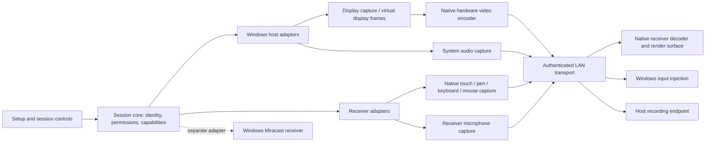

# Architecture

## Stack status

The user delegated the stack decision after reviewing C++, Rust, Go, and Zig. Select **C++20 for the native engine, C++/WinRT with WinUI 3/XAML for desktop setup and session controls, and Direct3D for native video presentation**. Start with a Windows 11 host and Windows tablet/PC receiver. See STACK.md for rationale, build boundaries, and implementation rules.

Use MSVC and CMake presets for the engine and native integration tests. Use SDK-supported MSBuild projects for WinUI/XAML and WDK driver components. Exact compatible SDK, compiler, Windows App SDK, and dependency versions will be pinned during the feasibility stage. Driver language/toolchain settings follow WDK support independently of the engine's C++20 setting.

Keep XAML controls separate from high-frequency input and decoded video. Use a native presentation surface integrated with WinUI; prove swap-chain presentation, focus, accessibility, coordinate mapping, and pointer capture in the first UI spike. Mobile receivers need their own native platform adapters and shells later. Share the engine where practical without imposing Windows UI or COM dependencies on the protocol/session logic.

## Components

The diagram describes the target architecture. Current evidence: interface-bound TCP, paired Mbed TLS 4.1.1 sessions, Credential Manager, GPU Desktop Duplication, GPU video-processor BGRA-to-NV12 scaling/conversion, DXGI-surface hardware H264 input, GPU-surface decoding, and GPU shader NV12-to-BGRA presentation on the decoder's device. The H264 path avoids application CPU raw-pixel buffers; compressed access units still use CPU/TLS. WIC JPEG remains an explicit diagnostic option. Native 3000x2000 with a 60 fps target and WinUI launchers are implemented. Production transport remains pending. See GPU.md, SECURITY.md, and H264.md.



## Custom LAN path

- **Session core:** identity, pairing, permissions, session state machine, capabilities, timing, and bounded queues. Native adapters stay behind narrow interfaces.
- **Host capture:** evaluate Windows.Graphics.Capture for consent-driven monitor/window capture and DXGI Desktop Duplication for monitor capture. Handle resize, device loss, lock, and display removal. Protected content has platform limits.
- **Extended display:** a separate IddCx/UMDF virtual monitor component supplies Windows with a true display. It produces frames through a different source adapter; capture alone does not create a monitor. Keep driver communication narrow and authenticated locally.
- **Media:** evaluate native WebRTC for H.264 hardware encode/decode and Opus audio. Codec support, licensing, GPU interop, dependency maintenance, and distribution need a recorded selection. Keep GPU surfaces native; bound queues and avoid per-frame base64/JSON copies. Negotiate additional codecs later.
- **Host input:** start with SendInput for keyboard/mouse and synthetic pointer APIs for touch/pen. Test real application delivery and integrity-level restrictions. Virtual HID is a later, evidence-driven compatibility option. Legacy WinTab and arbitrary raw HID behavior are not automatic.
- **Host audio:** native loopback capture and receiver playback with separate volume/mute. Decide whether host local playback stays active; forwarding mute must not silently change the system master volume.
- **Reverse microphone:** receiver capture, transport, decode/resample, then feed a Windows virtual recording endpoint. Evaluate a maintained redistributable endpoint versus a purpose-built signed audio driver. SYSVAD is a reference sample, not a functioning network microphone.

Keep network parsing, permission enforcement, and native injection behind explicit interfaces. UI actions invoke typed session commands; network events must pass authentication, permission, epoch, and bounds checks before injection. Run input handling in the interactive user session; a service in Session 0 is not a substitute for that agent. Elevated/secure-desktop access needs its own evaluated design.

## Windows+K path

Investigate Windows.Media.Miracast.MiracastReceiver on compatible Windows receiver hardware. Validate app model, CoreApplicationView requirements, capabilities, optional Windows components, packaging, and simultaneous coexistence with custom mode. A WinUI 3 desktop window is not automatically a CoreApplicationView; a separate compatible receiver component may be necessary.

The public MiracastReceiverInputDevices API documents keyboard and game-controller access; that is insufficient evidence for full pen/touch forwarding through this API. Measure the actual input path and user-consent behavior. Mic passthrough must not be assumed to exist in the Miracast path. If an enhanced companion channel is offered, both devices need our software and its permissions; native Windows+K operation must remain clearly identified.

Do not replace the OS Miracast stack with a custom protocol implementation before establishing a concrete need and feasibility. Custom LAN support can proceed independently if Miracast is hardware-limited.

## Proposed repository structure after decisions

```text
apps/desktop/             Desktop setup and session shell
core/session/             State, identity, permissions, capabilities
core/protocol/            Wire schema, limits, compatibility
platform/windows/         Capture, rendering, audio, input adapters
platform/receivers/       Additional native receiver adapters
drivers/virtual-display/  Optional extended-desktop integration
drivers/virtual-audio/    Optional recording-endpoint integration
experiments/              Bounded feasibility prototypes
tests/                    Meaningful protocol and integration checks
docs/                     Product and engineering decisions
```

Directories are proposed, not created placeholders. Driver components have independent packaging, signing, install/uninstall, and rollback paths. Pin exact compatible toolchain versions after native integration evidence.
